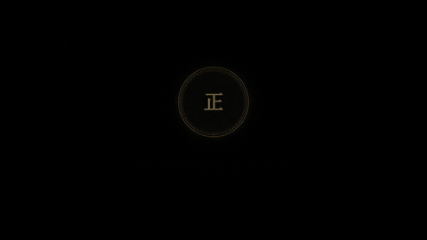

# Vibe Knowledge Video · 知识大赏

**给 AI 一个知识点，把它变成黑金纪录片风的动态信息图短视频。**

一枚硬币、一颗落珠、一条不断生长的曲线，都可以成为讲清一个概念的入口。这个 Skill 把选题、分镜、事实核查、动画渲染与配乐混音串成一套工作流，让 AI 编程助手用 Python 制作「知识大赏」风格的知识科普视频。

暖黑底色、金色强调、宋体字幕、档案式角标。没有旁白，用画面变化和字幕把故事讲完。

## 🎬 先看效果：《运气的形状》

以下是豆包、Claude、Codex、WorkBuddy 的四段样片。下方动图可直接预览；**点击动图或「完整视频」，打开带声音的完整 MP4 文件。**

| 豆包 · 10.5 秒 | Claude · 10 秒 |
| :---: | :---: |
| [](demos/doubao.mp4) | [](demos/claude.mp4) |
| 人群点阵里的好运与霉运 · [完整视频](demos/doubao.mp4) | 高尔顿板，落珠逐渐堆出形状 · [完整视频](demos/claude.mp4) |
| **Codex · 10 秒** | **WorkBuddy · 10 秒** |
| [](demos/codex.mp4) | [](demos/workbuddy.mp4) |
| 硬币 → 1024 种可能 → 分布图 · [完整视频](demos/codex.mp4) | 从一枚硬币到连续正面 · [完整视频](demos/workbuddy.mp4) |

## ✨ 这个 Skill 能做什么

- **把抽象概念变成画面**：概率分布、指数增长、认知偏差、历史经济与哲学心理，都可以从具体案例切入。
- **先写分镜，再做样片**：每个镜头写清楚画面怎么动、字幕怎么说、数字从哪里来；先看 10～30 秒，再决定完整版。
- **生成统一的黑金视觉**：衬线字体、关键词描金、金色辉光、暗角和颗粒，让字幕、图表和标题保持同一种风格。
- **让数据真正动起来**：曲线生长、点阵重排、数量累积、尺度旅行、物件变形，都通过代码逐帧绘制。
- **配乐与音效同步**：自带固定背景音乐，支持合成落点、提示音、颗粒声、低频冲击与金属余晖，并控制音乐避让和淡出。
- **保留可以修改的工程**：交付 Python 源码、分镜稿和视频；改一句字幕或一个镜头，就能局部重渲染。

默认规格为 **1920 × 1080、30 fps、16:9 横屏、无旁白**。完整版通常为 90～150 秒，也可以明确要求先出 10 秒样片。

## 🚀 快速开始

### 1. 安装 Skill

把下面这句话发给 AI：

```text
请帮我安装这个 Skill：https://github.com/YT-smart/vibe-knowledge-video
```

安装及制作视频所需的环境由 AI 准备。

### 2. 把需求交给 AI

**先做一个短样片：**

```text
使用 vibe-knowledge-video skill，做一个《运气的形状》的知识科普视频。
横屏 16:9，黑金纪录片风，无旁白，使用技能自带配乐。
先给我 10 秒样片，确认后再继续。
```

**让 AI 帮你找选题：**

```text
使用 vibe-knowledge-video skill，给我 10 个适合动画化的概率数学选题。
每个给出开头钩子、核心画面和结尾反转。
```

**制作完整视频：**

```text
使用 vibe-knowledge-video skill，把「生日悖论」做成约 2 分钟的视频。
先写分镜，核算每个数字，注明模型假设。
分镜确认后，先做开头 30 秒样片。
```

**修改局部镜头：**

```text
把第 4～7 秒的点阵聚合放慢，字幕缩短一点，保留配乐。
先导出这一段给我看。
```

## 🛠️ 它是怎样制作视频的

```text
知识点 / 选题
      ↓
钩子与叙事结构
      ↓
分镜、字幕、数字核算与出处
      ↓
关键帧预览 → 10～30 秒样片 → 根据反馈修改
      ↓
Python 逐帧渲染 + 背景音乐与音效混音
      ↓
FFmpeg 合成 MP4 + 保留工程源码
```

画面由 **Python + Pillow + NumPy** 绘制，默认以 2 倍尺寸超采样后缩小到 1080p。动画由时间参数驱动，同一时刻可以重复渲染，便于逐帧检查和局部修改。

## 📁 仓库结构

```text
vibe-knowledge-video/
├── SKILL.md                       # AI 工作流程与制作要求
├── README.md                      # 项目介绍与使用说明
├── assets/
│   └── bgm.m4a                    # 系列固定背景音乐
├── references/
│   ├── style_guide.md             # 黑金视觉规范
│   ├── storyboard.md              # 选题、字幕与事实核查
│   ├── example_storyboard.md      # 完整分镜范例
│   └── production.md              # 渲染、混音与制作说明
├── scripts/
│   ├── vkit.py                    # 绘图与逐帧渲染引擎
│   ├── sfx.py                     # 音效合成与音乐混音
│   └── example_video.py           # 《指数的形状》示例工程
└── demos/                         # 四段演示视频与动态预览
```

## 💡 适合用来做

知识科普短视频、数学与概率可视化、认知偏差讲解、历史经济故事，以及哲学心理主题的动态信息图。

从一条能被画出来的问题开始，让观众看见一个概念如何发生。
